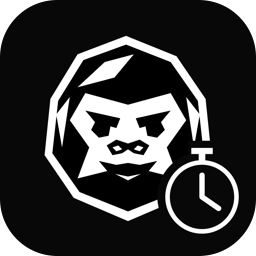
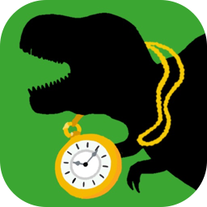

<picture>
<source media="(prefers-color-scheme: dark)" srcset="assets/headline-dark.svg">

</picture>

<h4>
<picture>
<source media="(prefers-color-scheme: dark)" srcset="assets/label-products-dark.svg">

</picture>
</h4>

<a href="https://apps.apple.com/jp/app/id6824240625"><b>浮世将棋</b></a>&nbsp;&nbsp;App Store 
木彫りの武士が盤上で動く、ひとり用の 3D 将棋 
<b>テーマ</b>　立体の駒が動く将棋 · 将棋 AI と強化学習 · AI による 3D モデル制作の自動化 
<code>Unity</code> <code>C#</code>
  

<a href="https://apps.apple.com/jp/app/gori-timer/id6824386388"><b>GORI TIMER</b></a>&nbsp;&nbsp;App Store 
時間とラウンド数を自由に組めるワークアウトタイマー 
<b>テーマ</b>　キックボクシングジムで使うタイマー · 有料になったアプリの代わりを自作 
<code>Swift</code> <code>SwiftUI</code>
  

<a href="https://apps.apple.com/jp/app/id6740161026"><b>Focusaurus</b></a>&nbsp;&nbsp;App Store 
集中した分だけ恐竜が育つ、スマホの使いすぎ対策タイマー 
<b>テーマ</b>　受験生のための育成ゲーム · スマホを置く集中タイム · ゲームの中で勉強 
<code>Unity</code> <code>C#</code>
  

<a href="https://github.com/soichiGogo/hoiku-agent"><b>HOIKUAGENT</b></a>&nbsp;&nbsp;Web 
保育士の勘所を吸収して、保育書類づくりを支援する AI エージェント 
<b>テーマ</b>　ハッカソンのテーマから着想 · 現場の勘所を AI エージェントのスキルに取り込む 
<code>Python</code> <code>Google ADK</code> <code>Gemini</code> <code>Cloud Run</code>
  

<h4>
<picture>
<source media="(prefers-color-scheme: dark)" srcset="assets/label-achievements-dark.svg">

</picture>
</h4>

🏆 [DevOps × AI Agent Hackathon 2026](https://cloud.google.com/blog/ja/products/ai-machine-learning/devops-ai-agent-hackathon-2026?hl=ja) 優秀賞（HOIKUAGENT）
